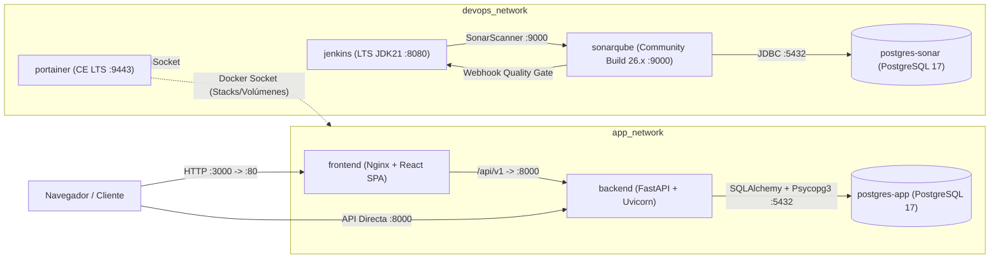

# Arquitectura del Sistema — Restaurante Smart

Este documento constituye la fuente única de verdad para nombres de servicios, puertos, redes, variables de entorno, responsabilidades por capa y reglas de seguridad de **Restaurante Smart**.

---

## 1. Visión General y Topología de Contenedores

La infraestructura se divide en dos redes bridge aisladas en Docker Compose (`app_network` y `devops_network`) y utiliza **dos instancias PostgreSQL completamente independientes**.

---

## 2. Tabla Maestra de Servicios, Puertos, Redes y Volúmenes

Todos los archivos (`docker-compose.yml`, `Dockerfile`, `Jenkinsfile`, `sonar-project.properties`, `.env.example` y configuraciones de aplicación) deben respetar exactamente estos identificadores:

| Servicio Docker (DNS) | Imagen fijada | Red Docker | Puerto contenedor | Puerto host | Volumen persistente | Healthcheck |
| :--- | :--- | :--- | :--- | :--- | :--- | :--- |
| `frontend` | Build `./frontend/Dockerfile` (`node:22-alpine` -> `nginx:alpine`) | `app_network` | `80` | `${FRONTEND_PORT:-3000}` | — (inmutable) | HTTP GET `/` |
| `backend` | Build `./backend/Dockerfile` (`python:3.13-slim-bookworm`) | `app_network` | `8000` | `${BACKEND_PORT:-8000}` | — (sin estado) | HTTP GET `/api/v1/health` |
| `postgres-app` | `postgres:17-alpine` | `app_network` | `5432` | `127.0.0.1:${APP_DB_PORT:-5432}` | `postgres_app_data` | `pg_isready` |
| `jenkins` | `jenkins/jenkins:lts-jdk21` (con herramientas/agentes documentados) | `devops_network` | `8080`, `50000` | `${JENKINS_PORT:-8080}`, `127.0.0.1:${JENKINS_AGENT_PORT:-50000}` | `jenkins_home` | HTTP GET `/login` |
| `sonarqube` | `sonarqube:26.11.0.134175-community` | `devops_network` | `9000` | `${SONARQUBE_PORT:-9000}` | `sonarqube_data`, `sonarqube_logs`, `sonarqube_extensions` | `/api/system/status` (`UP`) |
| `postgres-sonar` | `postgres:17-alpine` | `devops_network` | `5432` | No expuesto al host | `postgres_sonar_data` | `pg_isready` |
| `portainer` | `portainer/portainer-ce:2.45.x-lts` (tag LTS `>= 2.33.5` verificado en Fase 8/12) | `devops_network` | `9443` | `${PORTAINER_HTTPS_PORT:-9443}` | `portainer_data` | HTTPS/API status |

> **Nota sobre prevención de colisión en puerto `8000`:** Portainer CE suele publicar `8000` para Edge Agent Tunnel. Dado que el proyecto usa el socket Docker local y `backend` utiliza el puerto `8000`, Portainer expone exclusivamente el puerto HTTPS `9443`.

---

## 3. Variables de Entorno Canónicas

| Variable | Uso | Ejemplo sin secreto |
| :--- | :--- | :--- |
| `APP_ENV` | Entorno de ejecución | `development` / `production` |
| `APP_NAME` | Nombre visible de la API | `Restaurante Smart API` |
| `API_V1_PREFIX` | Prefijo versionado | `/api/v1` |
| `APP_DB_HOST` | Host DNS PostgreSQL app | `postgres-app` |
| `APP_DB_PORT` | Puerto PostgreSQL app | `5432` |
| `APP_DB_NAME` | Nombre BD app | `restaurante_smart` |
| `APP_DB_USER` | Usuario BD app | `restaurante_user` |
| `APP_DB_PASSWORD` | Contraseña BD app | `<definir-en-.env>` |
| `JWT_SECRET_KEY` | Clave firma JWT HS256 | `<generar-aleatorio-64-chars>` |
| `JWT_ALGORITHM` | Algoritmo JWT | `HS256` |
| `ACCESS_TOKEN_EXPIRE_MINUTES` | Expiración token de acceso | `60` |
| `CORS_ORIGINS` | Orígenes permitidos | `http://localhost:3000` |
| `VITE_API_BASE_URL` | Base URL consumida por frontend | `/api/v1` |
| `SONAR_DB_NAME` | Nombre BD SonarQube | `sonarqube` |
| `SONAR_DB_USER` | Usuario BD SonarQube | `sonar_user` |
| `SONAR_DB_PASSWORD` | Contraseña BD SonarQube | `<definir-en-.env>` |

---

## 4. Arquitectura Modular del Backend (FastAPI)

Se adopta una arquitectura por capas estricta con separación de responsabilidades:

1. **Capa API (`backend/app/api/v1/`):** Routers por recurso (`auth`, `users`, `roles`, `categories`, `products`, `tables`, `availability`, `reservations`, `orders`, `notifications`, `reports`, `health`). No contiene lógica de negocio ni SQL directo.
2. **Capa de Esquemas (`backend/app/schemas/`):** Contratos Pydantic v2 con validación estricta de tipos, rangos y formatos.
3. **Capa de Servicios (`backend/app/services/`):** Orquesta reglas de negocio, control transaccional (`with db.begin()`), cálculo de totales, validaciones de disponibilidad y emisión de notificaciones automáticas.
4. **Capa de Repositorios (`backend/app/repositories/`):** Encapsula consultas SQLAlchemy 2 parametrizadas, carga de relaciones y bloqueos `with_for_update()`.
5. **Capa de Modelos (`backend/app/models/`):** Mapeo declarativo SQLAlchemy 2 (`Mapped`, `mapped_column`) alineado 1:1 con las migraciones Alembic.
6. **Núcleo Transversal (`backend/app/core/`):** Configuración (`pydantic-settings`), hash seguro de contraseñas (`pwdlib[argon2]`), emisión/validación JWT (`PyJWT`), dependencias RBAC y manejador global de excepciones de dominio (`AppException` -> HTTP `4xx`/`5xx` estructurado sin fugar stack traces).

---

## 5. Arquitectura Modular del Frontend (React + TypeScript + Vite)

* **`config/`:** Lectura tipada de `import.meta.env.VITE_API_BASE_URL`.
* **`types/`:** Interfaces y tipos TypeScript sincronizados con los esquemas OpenAPI del backend.
* **`services/`:** Cliente HTTP tipado centralizado con inyección de token Bearer, manejo unificado de errores API y módulos por recurso (`authService`, `reservationsService`, `ordersService`, `menuService`, `tablesService`, `reportsService`, `usersService`).
* **`hooks/`:** Estado de autenticación/sesión (`useAuth`), control de permisos en UI y hooks de consulta/mutación.
* **`routes/`:** Configuración React Router v7 con guardas `ProtectedRoute` y `RoleGuard`.
* **`components/`:** Componentes reutilizables accesibles (layout responsivo, barra lateral, tablas paginadas, modales, alertas, formularios validados).
* **`pages/`:** Vistas por módulo funcional (Login, Dashboard, Usuarios, Categorías, Productos, Mesas, Disponibilidad, Calendario de Reservas, Pedidos, Seguimiento de Pedidos, Reportes).

---

## 6. Matriz de Autorización por Roles (RBAC)

Se definen 4 roles base y permisos granulares asociados:

| Rol | Código | Alcance principal |
| :--- | :--- | :--- |
| **Administrador** | `admin` | Control total del sistema: usuarios, roles/permisos, catálogo, mesas, reservas, pedidos, notificaciones y reportes. |
| **Gerente / Encargado** | `manager` | Gestión operativa completa (catálogo, mesas, disponibilidad, reservas, pedidos, notificaciones y reportes), sin modificar roles del sistema. |
| **Personal / Mesero / Cocina** | `staff` | Consulta disponibilidad, gestiona reservas (confirmar/completar/cancelar), crea y actualiza estados de pedidos y consulta mesas/productos. |
| **Cliente** | `customer` | Consulta catálogo y disponibilidad, crea y consulta sus propias reservas y pedidos en línea, recibe y marca como leídas sus notificaciones. |

---

## 7. Reglas Críticas de Negocio y Seguridad

1. **Prevención de reservas duplicadas (concurrencia):**
   * Toda reserva tiene `start_time` y `end_time` en UTC (`TIMESTAMPTZ`) con `end_time > start_time`.
   * Solo los estados activos (`pending`, `confirmed`) bloquean una mesa; `cancelled` y `no_show` liberan la franja.
   * En backend: transacción atómica con bloqueo de fila `SELECT ... FOR UPDATE` sobre `tables` + verificación de solapamiento + respaldo en base de datos mediante restricción `EXCLUDE USING gist` (`table_id WITH =, tstzrange(start_time, end_time, '[)') WITH &&`) para estados activos.
2. **Integridad de pedidos en línea:**
   * Los precios unitarios y totales nunca se confían desde el cliente: se consultan en servidor desde `products`, validando disponibilidad del producto (`is_available = true`) y stock/estado.
   * Flujo controlado de estados mediante tabla catálogo `order_statuses` (`pending` -> `confirmed` -> `preparing` -> `ready` -> `delivered`, o `cancelled` según reglas de transición).
3. **Confirmaciones automáticas:**
   * Al crear o cambiar el estado de una reserva o pedido, el servicio correspondiente registra automáticamente una notificación en `notifications` (y opcionalmente marca fecha/estado de confirmación) dentro de la misma transacción o flujo controlado.
4. **Estándar SonarQube:**
   * Clave única de proyecto: `restaurante-smart`
   * Nombre visible: `Restaurante Smart`
   * `sonar.python.version=3.13`
