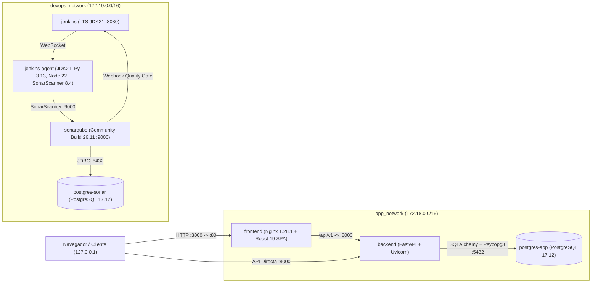

# Arquitectura del Sistema — Restaurante Smart

Este documento constituye la referencia de arquitectura para nombres de servicios, puertos, redes, variables de entorno, responsabilidades por capa y controles de seguridad de **Restaurante Smart**.

---

## 1. Visión General y Topología de Contenedores

La infraestructura se divide en dos redes bridge aisladas en Docker Compose (`app_network` y `devops_network`) y utiliza **dos instancias PostgreSQL 17.12 completamente independientes**. Ningún contenedor activo monta `/var/run/docker.sock`.

> **Estado de Portainer (`ops`):** El servicio `portainer` fue **retirado temporalmente** de `docker-compose.yml` tras la auditoría de seguridad (Fase 12) para evitar exponer `/var/run/docker.sock`. Su eventual incorporación futura requerirá una arquitectura endurecida sin montaje directo del socket (por ejemplo, proxy granular solo lectura evaluado en Fase 11.2).

---

## 2. Tabla Maestra de Servicios, Puertos, Redes y Volúmenes

| Servicio Docker (DNS) | Imagen fijada | Red Docker | Puerto contenedor | Puerto host (loopback) | Volumen persistente | Healthcheck |
| :--- | :--- | :--- | :--- | :--- | :--- | :--- |
| `frontend` | Build `./frontend/Dockerfile` (`node:22.23-alpine3.24` -> `nginx:1.28.1-alpine`) | `app_network` | `80` | `127.0.0.1:${FRONTEND_PORT:-3000}` | — (inmutable) | HTTP GET `/` |
| `backend` | Build `./backend/Dockerfile` (`python:3.13.18-slim-bookworm`) | `app_network` | `8000` | `127.0.0.1:${BACKEND_PORT:-8000}` | — (sin estado) | HTTP GET `/api/v1/health` |
| `postgres-app` | `postgres:17.12-alpine3.24` | `app_network` | `5432` | `127.0.0.1:${APP_DB_PORT:-5432}` | `postgres_app_data` (`external: true`) | `pg_isready` |
| `jenkins` | `jenkins/jenkins:2.580.2-lts-jdk21` (`0` ejecutores locales) | `devops_network` | `8080`, `50000` | `127.0.0.1:${JENKINS_PORT:-8080}`, `127.0.0.1:${JENKINS_AGENT_PORT:-50000}` | `jenkins_home` + `.ci-workspace:ro` | HTTP GET `/login` |
| `jenkins-agent` | Build `./jenkins/agent/Dockerfile` (`jenkins/inbound-agent:3395.v6e5377b_0fb_3c-5-jdk21`) | `devops_network` | — | Ninguno expuesto | `jenkins_agent_data` + `.ci-workspace:ro` | Proceso `agent.jar` activo |
| `sonarqube` | `sonarqube:26.11.0.134175-community` | `devops_network` | `9000` | `127.0.0.1:${SONARQUBE_PORT:-9000}` | `sonarqube_data`, `sonarqube_logs`, `sonarqube_extensions` | `/api/system/status` (`UP`) |
| `postgres-sonar` | `postgres:17.12-alpine3.24` | `devops_network` | `5432` | No expuesto al host | `postgres_sonar_data` | `pg_isready` |

> **Nota sobre `postgres-app`:** En el entorno actual `postgres-app` se ejecuta como contenedor independiente creado con `docker run` usando `postgres_app_data`. No debe ejecutarse `docker compose --profile app up -d` sobre esa instancia activa; para actualizar la aplicación sin tocar PostgreSQL debe usarse `docker compose up -d --no-deps backend frontend`.

---

## 3. Variables de Entorno Canónicas

| Variable | Uso | Ejemplo sin secreto |
| :--- | :--- | :--- |
| `APP_ENV` | Entorno de ejecución | `development` / `production` / `test` |
| `APP_NAME` | Nombre visible de la API | `Restaurante Smart API` |
| `API_V1_PREFIX` | Prefijo versionado | `/api/v1` |
| `TAX_RATE` | Tasa de impuesto aplicada en pedidos | `0.12` |
| `APP_DB_HOST` | Host DNS PostgreSQL app | `postgres-app` |
| `APP_DB_PORT` | Puerto PostgreSQL app | `5432` |
| `APP_DB_NAME` | Nombre BD app | `restaurante_smart` |
| `APP_DB_USER` | Usuario BD app | `restaurante_user` |
| `APP_DB_PASSWORD` | Contraseña BD app | `<definir-en-.env>` |
| `JWT_SECRET_KEY` | Clave firma JWT HS256 (`>= 32` chars) | `<generar-aleatorio-64-chars>` |
| `JWT_ALGORITHM` | Algoritmo JWT | `HS256` |
| `ACCESS_TOKEN_EXPIRE_MINUTES` | Expiración token de acceso | `60` |
| `CORS_ORIGINS` | Orígenes permitidos | `http://localhost:3000,http://127.0.0.1:3000` |
| `VITE_API_BASE_URL` | Base URL consumida por frontend | `/api/v1` |
| `SONAR_DB_HOST` | Host DNS PostgreSQL SonarQube | `postgres-sonar` |
| `SONAR_DB_PORT` | Puerto PostgreSQL SonarQube | `5432` |
| `SONAR_DB_NAME` | Nombre BD SonarQube | `sonarqube` |
| `SONAR_DB_USER` | Usuario BD SonarQube | `sonar_user` |
| `SONAR_DB_PASSWORD` | Contraseña BD SonarQube | `<definir-en-.env>` |
| `JENKINS_AGENT_SECRET` | Secreto WebSocket del nodo `restaurante-smart-agent` | `<definir-en-.env>` |

---

## 4. Arquitectura Modular del Backend (FastAPI)

Se adopta una arquitectura por capas estricta con separación de responsabilidades:

1. **Capa API (`backend/app/api/v1/`):** Routers por recurso (`auth`, `users`, `roles`, `categories`, `products`, `tables`, `availability`, `reservations`, `orders`, `notifications`, `reports`, `health`). No contiene lógica de negocio ni SQL directo.
2. **Capa de Esquemas (`backend/app/schemas/`):** Contratos Pydantic v2 con validación estricta de tipos, rangos y formatos.
3. **Capa de Servicios (`backend/app/services/`):** Orquesta reglas de negocio, control transaccional (`with db.begin()`), cálculo de totales, validaciones de disponibilidad y emisión de notificaciones automáticas.
4. **Capa de Repositorios (`backend/app/repositories/`):** Encapsula consultas SQLAlchemy 2 parametrizadas, carga de relaciones y bloqueos `with_for_update()`.
5. **Capa de Modelos (`backend/app/models/`):** Mapeo declarativo SQLAlchemy 2 (`Mapped`, `mapped_column`) alineado 1:1 con las migraciones Alembic.
6. **Núcleo Transversal (`backend/app/core/`):** Configuración (`pydantic-settings`), validación de seguridad al arranque vía `lifespan` en `main.py` (`validate_runtime_security()` cuando `APP_ENV != "test"` exigiendo `JWT_SECRET_KEY` fuerte y `JWT_ALGORITHM` dentro de `{HS256, HS384, HS512}`), hash Argon2id (`pwdlib`), JWT (`PyJWT`), rate limiting en memoria por proceso sobre `/auth/login` y `/auth/register` con validación de proxies de confianza (`TRUSTED_PROXY_IPS`), dependencias RBAC y manejador global de excepciones (`AppError` -> JSON estructurado sin trazas internas).

---

## 5. Arquitectura Modular del Frontend (React 19 + TypeScript + Vite)

* **`config/`:** Lectura tipada de `import.meta.env.VITE_API_BASE_URL` (por defecto `/api/v1`).
* **`types/`:** Interfaces y tipos TypeScript sincronizados con los esquemas OpenAPI del backend (incluyendo `ReservationUpdatePayload`).
* **`services/`:** Cliente HTTP Axios tipado centralizado (`httpClient.ts`) con inyección de token Bearer desde `localStorage` (`rs_access_token`), manejo unificado de errores `ApiClientError` (incluyendo timeouts `408`, red `0` y detalles `422`), servicios completos por recurso (`authService`, `usersService`, `catalogService`, `tablesService.getTable`, `reservationsService.updateReservation`, `ordersService`, `notificationsService`, `reportsService`).
* **`hooks/`:** Estado de autenticación/sesión (`AuthContext`, `useAuth`) y carga asíncrona con descarte de respuestas obsoletas (`useAsyncResource`).
* **`routes/`:** Configuración con **React Router 8.5.1** y guardas `ProtectedRoute` por rol (incluyendo `/profile` accesible a todo usuario autenticado).
* **`components/`:** Componentes reutilizables accesibles (`AppLayout` con cierre `Escape` y backdrop móvil, `AlertBanner`, `LoadingState`, `Modal` con `role="dialog"`, `PaginationControls`, `StatusBadge`).
* **`pages/`:** Vistas completas por módulo (`LoginPage`, `DashboardPage`, `UsersPage`, `CatalogPage`, `TablesPage`, `AvailabilityPage`, `ReservationsPage`, `OrdersPage`, `NotificationsPage`, `ProfilePage`, `ReportsPage`).

### Seguridad Frontend (CSP y Almacenamiento JWT)

* **Content Security Policy (`frontend/nginx.conf`):** Configurada de forma explícita y repetida en `/`, `/assets/` y nivel `server` para evitar pérdida por herencia de `add_header`:
  `default-src 'self'; script-src 'self'; style-src 'self' 'unsafe-inline'; img-src 'self' data:; font-src 'self'; connect-src 'self'; object-src 'none'; base-uri 'self'; frame-ancestors 'none'; form-action 'self'`
  acompañada de `X-Frame-Options: DENY`, `X-Content-Type-Options: nosniff`, `Referrer-Policy` y `Permissions-Policy`. Se mantiene `'unsafe-inline'` únicamente en `style-src` para soportar atributos `style={{...}}` de React sin permitir `script-src 'unsafe-inline'` ni `'unsafe-eval'`.
* **Riesgo residual de JWT en `localStorage`:** La aplicación utiliza el esquema Bearer actual (`rs_access_token` en `localStorage`). Aunque la `CSP` reduce significativamente la superficie de inyección y ejecución de scripts, **ninguna CSP convierte en inmune al sistema frente a XSS**. Como mejora futura recomendada, puede evaluarse migrar a cookies `HttpOnly; SameSite=Lax` emitidas por FastAPI con los ajustes correspondientes de CORS, backend y pruebas.

---

## 6. Matriz de Autorización por Roles (RBAC)

| Rol | Código | Alcance principal |
| :--- | :--- | :--- |
| **Administrador** | `admin` | Control total del sistema: usuarios, roles/permisos, catálogo, mesas, reservas, pedidos, notificaciones y reportes. |
| **Gerente / Encargado** | `manager` | Gestión operativa completa (catálogo, mesas, disponibilidad, reservas, pedidos, notificaciones y reportes), sin modificar roles del sistema. |
| **Personal / Mesero / Cocina** | `staff` | Consulta disponibilidad, gestiona reservas (confirmar/completar/cancelar), crea y actualiza estados de pedidos y consulta mesas/productos. |
| **Cliente** | `customer` | Consulta catálogo y disponibilidad, crea y consulta sus propias reservas y pedidos en línea, recibe y marca como leídas sus notificaciones. |

---

## 7. Reglas Críticas de Negocio, Seguridad y CI/CD

1. **Prevención de reservas duplicadas (concurrencia):** `SELECT ... FOR UPDATE` sobre `tables` en backend + restricción PostgreSQL `EXCLUDE USING gist` (`uq_reservations_no_overlap`) sobre estados activos (`pending`, `confirmed`) en UTC (`TIMESTAMPTZ`).
2. **Integridad de pedidos en línea:** Precios y totales calculados exclusivamente en servidor desde `products`, nunca confiados desde el cliente.
3. **Aislamiento CI/CD (Jenkins + Workspace Aislado):**
   * Ni el controlador Jenkins ni `jenkins-agent` montan `/var/run/docker.sock` ni ejecutan `privileged`.
   * En Compose se declara el montaje de solo lectura `./.ci-workspace:/workspace/restaurante-smart:ro`, preparado mediante `./jenkins/prepare-workspace.sh` a partir de `git ls-files` excluyendo `.env`, secretos locales, `.venv`, `node_modules` y artefactos.
   * **Limitaciones actuales de CI/CD:** la construcción de imágenes Docker dentro del pipeline (Etapa 13 de `Jenkinsfile`) permanece pendiente/documentada hasta disponer de un servicio `buildkitd` rootless aislado o runner externo dedicado; las pruebas integrales reales contra PostgreSQL requieren `RUN_POSTGRES_TESTS=1` y una `TEST_DATABASE_URL` aislada (nunca `restaurante_smart`), por lo que se omiten en el agente aislado.
4. **Estándar SonarQube:**
   * Clave única de proyecto: `restaurante-smart` (`Restaurante Smart`, `sonar.python.version=3.13`).
