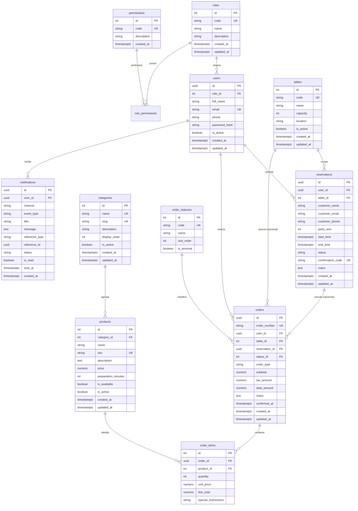

# Modelo de Datos Relacional — Restaurante Smart

La base de datos de la aplicación utiliza exclusivamente **PostgreSQL 17** (`postgres-app`). Todas las tablas se administran mediante **Alembic**, utilizando tipos `TIMESTAMPTZ` en UTC para fechas y horas.

---

## 1. Diagrama Entidad-Relación (ERD)



---

## 2. Reglas de Integridad, Restricciones e Índices

### Seguridad e Identidad (`roles`, `permissions`, `role_permissions`, `users`)
* `users.email` único e indexado en minúsculas.
* `users.password_hash` almacenado con Argon2id (nunca texto plano).
* `role_permissions` con clave primaria compuesta `(role_id, permission_id)` y eliminación en cascada controlada.

### Mesas y Reservas (`tables`, `reservations`)
* `tables.capacity > 0` (`CHECK`).
* `reservations.party_size > 0` (`CHECK`).
* `reservations.end_time > reservations.start_time` (`CHECK`).
* `reservations.status` restringido a valores válidos: `pending`, `confirmed`, `completed`, `cancelled`, `no_show`.
* **Restricción anti-solapamiento (PostgreSQL `btree_gist`):**
  ```sql
  ALTER TABLE reservations
  ADD CONSTRAINT uq_reservations_no_overlap
  EXCLUDE USING gist (
      table_id WITH =,
      tstzrange(start_time, end_time, '[)') WITH &&
  )
  WHERE (status IN ('pending', 'confirmed'));
  ```
  Esto garantiza a nivel de motor de base de datos que dos reservas activas nunca puedan superponerse en la misma mesa, incluso bajo peticiones concurrentes.
* Índices en `(table_id, start_time, end_time)`, `user_id`, `status` y `confirmation_code`.

### Catálogo y Pedidos (`categories`, `products`, `order_statuses`, `orders`, `order_items`)
* `products.price >= 0` (`CHECK`), tipo `NUMERIC(10, 2)` (evita errores de punto flotante).
* `orders.order_type` restringido a: `dine_in`, `takeaway`, `delivery`.
* `orders.subtotal >= 0`, `orders.tax_amount >= 0`, `orders.total_amount >= 0` (`CHECK`).
* `order_items.quantity > 0`, `unit_price >= 0`, `line_total >= 0` (`CHECK`), índice por `order_id`.
* `orders.table_id` y `orders.reservation_id` anulables (un pedido para llevar/domicilio no requiere mesa).

### Notificaciones (`notifications`)
* `channel`: `in_app`, `email_simulated`.
* `status`: `pending`, `sent`, `failed`.
* Índice compuesto `(user_id, is_read, created_at DESC)` para bandeja rápida del usuario.
